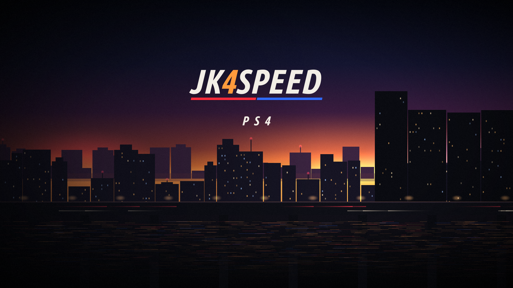

# JK4SPEED

Play your own PC copy of **Need for Speed: Most Wanted (2005)** on a PS4 with GoldHEN, with the Xbox 360 look.

[](https://github.com/Salru13/Jk4Speed/releases/latest)
[](https://github.com/Salru13/Jk4Speed/releases)
[](https://hits.sh/github.com/Salru13/Jk4Speed/)
-0070d1)


JK4SPEED is a PS4 app with its own launcher, the Wine runtime for the console from [JkFlow](https://github.com/Salru13/JkFlow) and a native DXVK renderer. You bring the game and download the mods from their authors; JK4SPEED checks your Most Wanted folder, builds the Xbox 360 look on your console and starts the game. JK4SPEED ships **no game files and no mod files**. This repository holds the source of the launcher and the title build, and the licence texts shipped in the package. Player guide: [README-player.md](README-player.md). More pages: [docs/](docs/).

## Requirements

| What | Details |
|---|---|
| Console | A **jailbroken PS4** running **GoldHEN** (to install homebrew PKGs). |
| Game | Your own copy of **Need for Speed: Most Wanted PC v1.3 Black Edition**. No other version is supported. `speed.exe` must be v1.3 (6,029,312 bytes). |
| Mods | The **Xbox 360 Stuff Pack (required)** and, if you like, the Upscaled HUD and HD Road Textures, downloaded from their authors' pages (below). |
| USB drive | To bring the mods and your PC saves to the console (FTP to `/data/Jk4Speed/` works too). |

We do not ship, sell or link to copies of the game. Please do not ask for them.

## Download

Get the `.pkg` from the [Releases](https://github.com/Salru13/Jk4Speed/releases) page (only there).

## Getting started

1. Download the JK4SPEED `.pkg` from the Releases page.
2. Optional: check the download on a PC (see [Official builds and verification](#official-builds-and-verification)).
3. Install the PKG on the PS4 with GoldHEN's package installer (or your usual homebrew PKG installer).
4. Copy your game folder (PC v1.3 Black Edition, untouched) to the console with FTP or a USB drive.
   `speed.exe` must sit directly in the game folder. The launcher shows the exact path on the **PATCH**
   screen if it cannot find the game.
5. Start **JK4SPEED** from the home screen. The first start shows **SETTING UP JK4SPEED** for about a minute or two
   (the Windows files the game needs are copied to `/data/Jk4Speed/System`). This happens once.

## The launcher: PLAY, PATCH, SETTINGS

The JK4SPEED launcher opens first. It has three items on its home screen:

| Item | What it does |
|---|---|
| **PLAY** | Starts the game. |
| **PATCH** | Checks your game folder, installs the JK4SPEED files and builds the mod files from the archives in `/data/Jk4Speed/Mods` (or `USB:/Jk4Speed/`). Anything it replaces is backed up first, and **Restore** puts it back. `SETTINGS > MODS` (or `PATCH > □ Mods`): the Xbox 360 Stuff Pack is **REQUIRED**; the Upscaled HUD and HD Road Textures each have an ON / OFF switch (ON by default). The first PATCH takes a few minutes (the pack is about 1 GB); the screen shows what it is reading, building and checking, in MB. |
| **SETTINGS** | **FRAME RATE**, **SHOW FPS / MS**, **MODS**, **CONTROLS** (controller layout), **SAVE GAMES**, **LOGS & SUPPORT** (Enable logs, Clear logs, Save support bundle) and **ABOUT**. |

On the game's title screen, wait until "Please press START" has fully faded in before you press ✕.

## Mods — where to get them

JK4SPEED looks like the Xbox 360 version of Most Wanted because of community mods. **JK4SPEED does not
include them.** Download each one from its author, the same way you bring the game. Please download from
these pages so the authors get the credit and the visits.

| Mod | Author | Official page | Archive file name | SHA-256 |
|---|---|---|---|---|
| **Xbox 360 Stuff Pack v4.2 (required)** | elaymm4 and many others (see [CREDITS.md](CREDITS.md)) | https://nfsmods.xyz/mod/1200 | On the Google Drive page, download the **whole "Complex Installation" folder**. Google Drive zips it into one or more files such as `Complex Installation-20261124T090016Z-1-001.zip`. Put **all** parts in. | no whole-archive hash: JK4SPEED checks every file it uses inside the pack by its own SHA-256 |
| NFSMW: Upscaled HUD (optional) | LunicAura106 | https://nfsmods.xyz/mod/1096 | **only** `NFSMWUHUD01022026b.7z` (2 January 2026). Older versions such as `NFSMWUHUD11302024a.7z` are not used. | `61d793dea108eafff9a57484e86b2e2c6d6a888a537f9de8fac19c436f189660` |
| NFSMW HD Road Textures (optional) | N4SRazer | https://www.nfsaddons.com/downloads/nfsmw/tools/5410/nfsmw-hd-road-textures.html | the ZIP from that page (any file name) | `7857e85120564227fe90ec0667cc9414c90136e1937431fe59bd321e0bbce4e9` |

### Step by step

1. Download the mods from the pages above. **Do not unpack them.**
2. Put each archive, **still zipped**, in `/data/Jk4Speed/Mods/` on the console (FTP), or in `USB:/Jk4Speed/` on a
   USB drive:
   ```
   /data/Jk4Speed/Mods/<all "Complex Installation" zip parts>
   /data/Jk4Speed/Mods/NFSMWUHUD01022026b.7z
   /data/Jk4Speed/Mods/<the HD Road Textures zip>
   ```
   Over FTP, use file names **without spaces** (rename `Complex Installation-...zip` to `Complex_Installation-...zip`):
   the console's FTP server refuses names with spaces. JK4SPEED accepts any name.
3. Plug the drive into the PS4, open JK4SPEED and press **PATCH**.

Your game folder only needs to be the untouched PC v1.3 Black Edition. Do **not** install the pack on the PC
first: JK4SPEED does that part on the console, from the pack's own files.

### Patch levels

| You dropped | You get |
|---|---|
| no X360 Stuff Pack | PATCH refuses and says which download is missing (without the pack the PC game is stretched on a 16:9 TV) |
| the X360 Stuff Pack | **X360 base**: the Xbox 360 look |
| the pack + Upscaled HUD | X360 base **+ HD HUD** |
| the pack + HD Road Textures | X360 base **+ HD road** |
| all three | X360 base **+ HD HUD + HD road** |

- **The X360 Stuff Pack is required.** The HUD and the road are optional extras on top of it.
- Every archive is checked first. The HUD 7z and the road ZIP must match the SHA-256 above byte for byte. A damaged
  or different archive is named on screen and skipped.
- **Add a mod later**: drop the archive in `USB:/Jk4Speed/` and press **PATCH** again; it is picked up. Remove one and
  press **PATCH**: its files go and your originals come back.
- PATCH is atomic: everything is built and checked first, then swapped in. If something fails or the console loses
  power, your game folder stays as it was.
- Your 30/60 FPS choice is kept across PATCH runs.

## Frame rate

**SETTINGS → FRAME RATE**: **30** or **60**.

| Setting | What you get |
|---|---|
| **30** (default) | An even 30 FPS. The smoothest option: in our tests about 97 % of frames land on time. |
| **60** | Up to 60 FPS in races, but less even than 30 (some frames arrive late, which you may feel as judder). |

Pick what feels best to you; you can switch at any time.

## Controls

DualShock 4 layout (also shown in **SETTINGS → CONTROLS**). No rebinding in this version.

| DS4 | Action |
|---|---|
| R2 | Gas |
| L2 | Brake / reverse |
| R1 | Shift up |
| L1 | Shift down |
| Square | Nitro (N2O) |
| Triangle | Speedbreaker |
| Cross | Handbrake / accept (menus) |
| Circle | Brake / back (menus) |
| R3 | Change camera view |
| Right stick pulled back | Look behind (hold) |
| L3 | Reset car |
| Options | Pause |
| Left stick | Steering |
| D-pad | Menu navigation |

## Save games

Your saves live in `/data/Jk4Speed/Saves/NFS Most Wanted/`, one folder per profile. **SETTINGS → SAVE GAMES**
shows where. Saves from **PC v1.3 Black Edition** are supported; saves made with other mods (extra cars, for
example) may not load.

### Bring your PC save

1. On the PC, copy `Documents\NFS Most Wanted` to **`USB:/Jk4Speed/saves/`** (the whole folder, just its profile
   folders, or a zip of them).
2. Plug the drive into the PS4 and open **SETTINGS → SAVE GAMES → Import**.
3. Pick what to import and press ✕. If a profile with the same name already exists, choose **Overwrite** or
   **Keep both**.

Your current console saves are backed up before anything changes.

### Export

**SETTINGS → SAVE GAMES → Export to USB**. The copy lands in `USB:/Jk4Speed/saves/<date>/NFS Most Wanted/`
and never overwrites an earlier export. On the PC, copy the profile folders into `Documents\NFS Most Wanted\`.

### Rename your profile

The game has no on-screen keyboard on the PS4, so a new profile keeps the default name **`NAME`**. To give it
your own name, close the game and open **SETTINGS → SAVE GAMES → Player name**. Type the name with the
launcher's on-screen keyboard (letters and digits, 1 to 15 characters). The launcher backs up the save, writes
the new name into it (with its checksums) and renames the folder and file.

## Official builds and verification

Official JK4SPEED releases come **only** from https://github.com/Salru13/Jk4Speed.

The badge in the top-right corner of the launcher (details in **SETTINGS → ABOUT**):

| Badge | Meaning |
|---|---|
| **Official Build by XxXJoker13XxX** | The files of this copy match the list signed with the JK4SPEED release key (Ed25519, key ID `AC6DB37B`, shown in ABOUT). |
| **Unofficial build** | This copy could not be verified. It may have been changed or repackaged by someone else. It still runs normally; nothing is turned off. |

If you got JK4SPEED anywhere else and it shows **Unofficial build**, get the official release from the GitHub page
above. Forks are welcome under the code licences, but they must not call themselves official.

## FAQ

### Where does my game go?

Copy the whole game folder of Most Wanted PC v1.3 Black Edition into `/data/Jk4Speed/NFSMW`, over FTP or with a USB drive. `speed.exe` must be directly in this folder, not in a folder inside it. Upper or lower case does not matter. Then open Patch and press the cross button to install. Only use a copy of Most Wanted you own.

### Game not found

The folder must be `/data/Jk4Speed/NFSMW`, with `speed.exe` directly in it.

### Two game folders

The console sees `NFSMW` and `nfsmw` as two folders. Keep only one, then start Jk4Speed again. Jk4Speed does not guess which one is yours, and it changes nothing until there is only one.

### Unsupported game version

Only Most Wanted PC v1.3 Black Edition works. Copy the game folder of a v1.3 Black Edition install from your PC.

### 30 FPS or 60 FPS?

Choose it in **Settings > Frame rate**. **30 FPS**: races run at an even 30 frames per second, the smoothest. **60 FPS**: races run at up to 60 frames per second, less even.

### How do I use mods?

Mods are not part of Jk4Speed. Get each one from its author's page (Settings > Mods shows where) and put the download, unchanged and still zipped, in `/data/Jk4Speed/Mods` or `USB:/Jk4Speed`:

- **Xbox 360 Stuff Pack v4.2 (required)**: on its Google Drive page, download the whole **"Complex Installation"** folder. Google Drive gives you one or more zips; put all of them in.
- **Upscaled HUD (optional)**: only `NFSMWUHUD01022026b.7z` (2 January 2026). Older versions are not used.
- **HD Road Textures (optional)**: the zip from N4SRazer's page.

Over FTP, use file names without spaces (the console's FTP server refuses them); Jk4Speed accepts any name.

Then press **Patch**. The pack is always on; turn the HUD and the roads on or off in **Settings > Mods**.

Turning a mod off puts your original game files back: Patch keeps an unchanged copy of every game file a mod replaces, so it never needs the download for that. A mod that is on but whose download is gone stays installed as it is.

### Archive damaged or not found

Download it again from the author's page and put it back, still zipped, in `/data/Jk4Speed/Mods` or `USB:/Jk4Speed`.

### Mods can't be changed

Patch keeps an unchanged copy of each game file a mod replaces. When your game folder already had mods in it before Jk4Speed, there is none, and Patch says "Mods can't be changed". Your game still plays as it is now.

To fix it: copy the game folder again from a PC install without mods, then press Patch. Your saves stay.

### Patch was interrupted

The last Patch stopped before it finished: the console lost power or the app was closed. Every game file was put back as it was before that Patch. Nothing was lost. Press Patch again.

If the files could not be put back right away, JK4SPEED opens on the Patch screen with the reason, and Play opens Patch until it is fixed: the game never starts on half-changed files. Press the cross button: Patch first puts back the files it had swapped, then tries again. If the record of that Patch is damaged, Patch puts back the files it can check and keeps every other file aside. Nothing is deleted.

### Not enough free space

Free some space on the PS4, then press Patch again. Patch works in steps: the Jk4Speed files, then the game's Wine prefix (about 330 MB, the first time), then an unchanged copy of the game files it manages (the road file alone is 532 MB), then the mods. Before the Jk4Speed files, the unchanged copies and the mods it checks the free space; when there is not enough, that step stops before it writes anything and says how much space it needs. Steps that already finished stay done, and the next Patch carries on. If the console does not report its free space, Patch goes ahead.

### How do I put everything back?

On the Patch screen press the triangle button (**Restore backup**). It removes the Jk4Speed files, turns every mod off, and puts back the files Jk4Speed replaced or moved aside, your own `jk4speed-dev.ini` included. Two things stay as they are:

- a game file that had no unchanged copy (your game folder already had mods in it before Jk4Speed): the screen names it;
- a `jk4speed-dev.ini` you changed by hand after Jk4Speed wrote it.

The game will not start from here until you install again.

### Do settings change my game folder before the first Patch?

No. Settings you change before the first Patch are saved and used from the first Patch on. Nothing is written into your game folder until you press Patch.

### Where are my saves?

In `/data/Jk4Speed/Saves`, one folder per profile inside `NFS Most Wanted`. To bring a PC save: copy `Documents\NFS Most Wanted` to `USB:/Jk4Speed/saves/`, open Settings > Save games and press the square button Import. Your current saves are backed up first. To take them to a PC: Settings > Save games, cross button Export to USB; the copy goes to `USB:/Jk4Speed/saves/<date>/`. Saves from v1.3 Black Edition work. Saves made with other mods (extra cars, for example) may not load.

### What is Settings > Show FPS / ms?

It shows the frames per second and the frame time in ms in the top right corner while you race. Off is fastest.

### Logs, Clear logs and the support bundle

- **Enable logs** (Settings > Logs & Support) is off by default. It writes game logs to `/data/Jk4Speed/Logs` while you play. Turn it on only when something goes wrong.
- **Clear logs** deletes the game logs and the support bundles in `/data/Jk4Speed/Logs`. Your saves and settings stay.
- **Save support bundle** collects the logs of the last runs and your settings into one folder in `/data/Jk4Speed/Logs`. It holds no saves and no personal data. With a USB drive plugged in, it is copied there too. Get it with FTP.

### The game didn't start

In Settings > Logs & Support turn on Enable logs, play again, then save a support bundle.

### Official build or unofficial build?

The corner badge says "Official Build by XxXJoker13XxX" only for a copy that matches the signed list of the JK4SPEED project; every other copy says "Unofficial build". It still works as normal. Get the official release from github.com/Salru13/Jk4Speed.

## Support

JK4SPEED has no contact address. If something goes wrong:

1. Read the [FAQ](#faq) and Help in JK4SPEED (Square on the Home screen).
2. Make a support bundle (**Settings > Logs & Support > Save support bundle**) and copy its folder to a PC over FTP.
3. Open an issue on [GitHub Issues](https://github.com/Salru13/Jk4Speed/issues): say what you did and what you saw, and attach the support bundle files.

## Repository layout

| Path | What |
|---|---|
| `launcher/` | The JK4SPEED launcher: PLAY / PATCH / SETTINGS, the mod patcher, save tools and the Official Build check. Host tests: `launcher/tests/run.sh` (Linux/WSL). |
| `title/` | How the PS4 title is built from the Wine PS4 runtime and the launcher, and how the package is made and signed. |
| `README-player.md` | The player guide (shipped in the package). |
| `docs/` | Player pages: mods, save games, FAQ. |
| `launcher/third_party/` | TweetNaCl (public domain), used for the Official Build signature check. |
| `.github/` | Ko-fi funding link. |
| `probe/`, `templates/` | Pre-flight probe; runtime profile and registry templates. |
| `LICENSE`, `LICENSES.md`, `THIRD_PARTY.md`, `SOURCES.txt`, `CREDITS.md`, `LICENSES/` | Licences, sources and credits. |

## Building

Launcher host tests (Linux or WSL; Ubuntu 24.04 tested):

```bash
sudo apt install build-essential python3 libfreetype-dev
bash launcher/tests/run.sh
```

This builds the assets and runs every test with ASan and UBSan. The package build is described in [title/README.md](title/README.md).

## Licence

- The JK4SPEED launcher, the title integration and the build scripts in this repository are LGPL-2.1-or-later ([LICENSE](LICENSE), [LICENSES/LGPL-2.1.txt](LICENSES/LGPL-2.1.txt)). Unless a file says otherwise, everything in this repository is LGPL-2.1-or-later.
- The Wine PS4 runtime is JkFlow's and keeps Wine's LGPL-2.1-or-later; where its source is: [SOURCES.txt](SOURCES.txt).
- Native DXVK (our changes in `dxvknative.prx` and `d3d9.dll`) is free to use with the credit line **"Native DXVK by XxXJoker13XxX"** ([LICENSES/Native-DXVK.txt](LICENSES/Native-DXVK.txt)). Its source is not published. The DXVK base stays zlib/libpng.
- What ships in the package and under which licence: [LICENSES.md](LICENSES.md), [THIRD_PARTY.md](THIRD_PARTY.md).

## Credits

- The Xbox 360 Stuff Pack by elaymm4, Toru the Red Fox, xan1242 and many others ([nfsmods.xyz/mod/1200](https://nfsmods.xyz/mod/1200)), the Upscaled HUD by LunicAura106 ([nfsmods.xyz/mod/1096](https://nfsmods.xyz/mod/1096)) and the HD Road Textures by N4SRazer ([nfsaddons.com](https://www.nfsaddons.com/downloads/nfsmw/tools/5410/nfsmw-hd-road-textures.html)), downloaded by the player. Every name from their credits is in [CREDITS.md](CREDITS.md).
- [Ultimate ASI Loader](https://github.com/ThirteenAG/Ultimate-ASI-Loader) by ThirteenAG, [Xidi](https://github.com/samuelgr/Xidi) by Samuel Grossman, [Xenon Effects](https://github.com/xan1242/NFSMW_XenonEffects) by xan1242.
- [orbis-win](https://github.com/plastikman/orbis-win) and the PS4 Wine port by [plastikman](https://github.com/plastikman); the original Wine console port by [mpereiraesaa](https://github.com/mpereiraesaa); [orbis-compat](https://github.com/orbis-ports/orbis-compat), the [OpenOrbis](https://github.com/OpenOrbis) toolchain and the [orbis-porting-kit](https://github.com/orbis-ports/orbis-porting-kit).
- Wine, Mesa/RADV, [DXVK](https://github.com/doitsujin/dxvk) (Philip Rebohle, Joshua Ashton), LLVM: the stack underneath. TweetNaCl (public domain) checks the Official Build signature. The launcher font is Ubuntu Sans.
- The JK4SPEED launcher, the Wine runtime from [JkFlow](https://github.com/Salru13/JkFlow) and Native DXVK by XxXJoker13XxX.

## Disclaimer

JK4SPEED is an unofficial fan project. It is **not affiliated with, made by or endorsed by Electronic Arts**.
Need for Speed and Need for Speed: Most Wanted are trademarks of Electronic Arts. JK4SPEED contains no EA game
files; you use your own copy of the game. PlayStation and PS4 are trademarks of Sony Interactive Entertainment;
JK4SPEED is not affiliated with Sony. JK4SPEED is not affiliated with the authors of the mods it works with. Homebrew on a PS4 is at your own risk.
